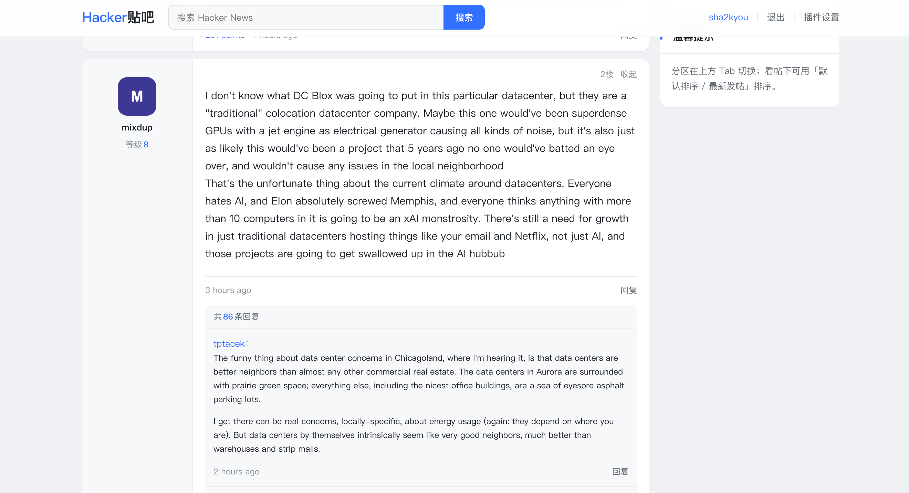

# HackerBa

Chrome 扩展：把 [Hacker News](https://news.ycombinator.com) 改造成贴吧式阅读界面。

界面仿经典百度贴吧吧页 / 看帖页；内容仍来自 Hacker News（列表、帖子、搜索等）。

## 界面预览

### 列表页


### 看帖页



## 功能

- 列表页：回复数、标题、作者与时间、域名外链、贴吧式分页
- 看帖页：标题栏、楼层卡片、楼主标识、楼中楼回复
- 分区 Tab：看帖 / 问答 / 作品 / 招聘 / 精品
- 页内搜索（Algolia HN API）
- 选项页：语言（跟随浏览器 / English / 中文；默认跟随，非中文浏览器为英文）、主题、信息密度、点击标题进入评论

## 安装（开发者模式）

1. 打开 `chrome://extensions`
2. 开启「开发者模式」
3. 「加载已解压的扩展程序」
4. 选择本仓库根目录（含 `manifest.json`）

加载后访问 `https://news.ycombinator.com/*` 即可。扩展详情页可打开「扩展程序选项」调整偏好。

## 开发

```bash
npm install
npm test
```

主要文件：

| 路径 | 说明 |
| --- | --- |
| `manifest.json` | Manifest V3 配置 |
| `src/content-script.js` | 页面改造逻辑 |
| `src/hackerba.css` | 贴吧样式 |
| `src/options.html` / `src/options.js` | 选项页 |
| `test/` | 单元测试 |

修改代码后在 `chrome://extensions` 点扩展的「重新加载」，再刷新 HN 页面。

## 许可

[MIT](LICENSE)
